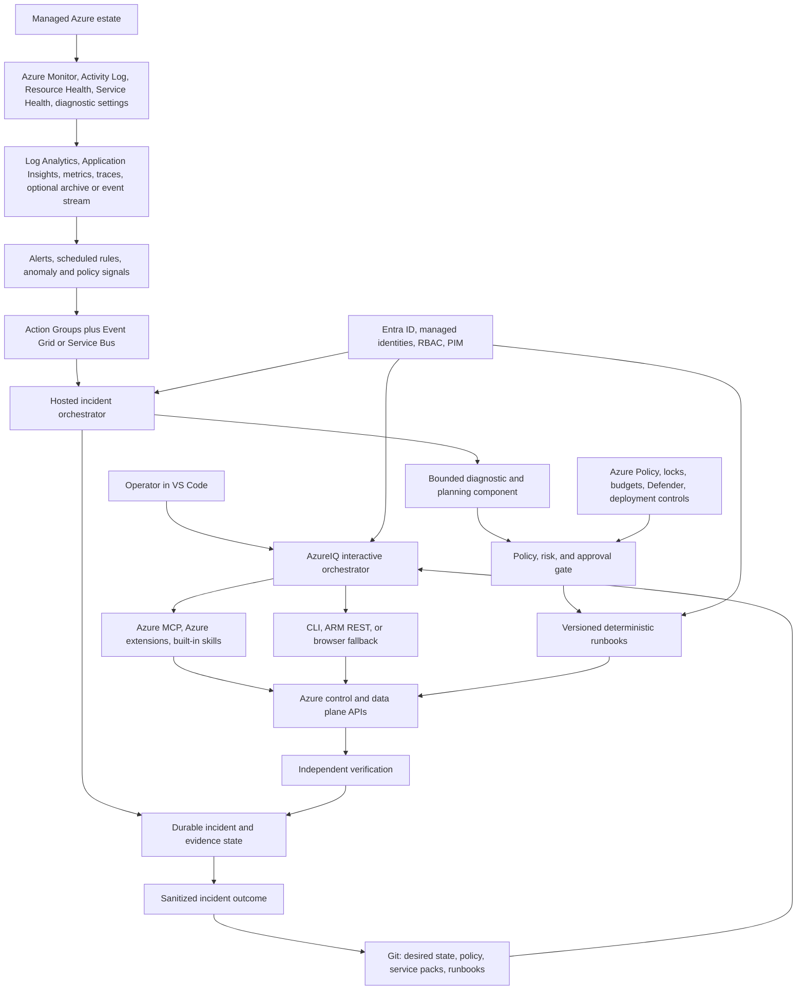

# AzureIQ Architecture

## Objective

AzureIQ should close an operational loop across Azure services:

1. Discover intended and actual state.
2. Observe health, performance, security, cost, and changes.
3. Correlate signals into an incident with preserved evidence.
4. Form a falsifiable diagnosis and identify missing evidence.
5. Propose a bounded remediation with risk, blast radius, rollback, and success criteria.
6. Apply policy and human approval gates.
7. Execute a deterministic action through a least-privileged identity.
8. Verify behavior and telemetry, then retain a sanitized outcome.

The model can help reason about evidence and choose a known runbook. It must not be the only control preventing a dangerous change.

## Logical Architecture

## Two Operating Planes

### Interactive plane

VS Code, GitHub Copilot, Azure MCP, installed service extensions, existing Azure skills, and the customizations in this repository form the engineering and incident-response console. This plane is appropriate for discovery, design, one-off diagnosis, IaC generation, reviewed changes, and supervised remediation.

It is not an always-on control plane. It stops when the session is closed, has no durable queue by default, and cannot guarantee that natural-language instructions will enforce an approval boundary.

Its intended operating mode is supervised management. Within configured scope, it should carry user commands through provisioning, configuration, deployment, remediation, and verification using Azure MCP first and IaC, CLI, SDK, ARM REST, or browser fallbacks where necessary. Read-only bootstrap exists only to establish identity, scope, and controls before that authority is enabled.

#### Interaction and routing

The user supplies an outcome or symptom, not an internal agent name. Ordinary GitHub Copilot Agent mode receives the always-on AzureIQ route contract. `AzureIQ Orchestrator` is the only visible AzureIQ custom agent and is an optional focused front door. Inventory, incident diagnosis, change planning, and verification agents are hidden specialists available for automatic invocation. Skills are also hidden from the slash menu and load by semantic relevance.

This routing is model-directed and best-effort. It can improve context isolation and tool restriction, but it is not deterministic orchestration. A routing failure falls back to the same workflow in the parent agent and must be disclosed. Authorization, scope enforcement, action allowlists, approval, and execution belong to deterministic controls outside model routing.

### Hosted operations plane

Continuous detection requires deployed Azure components. The exact runtime remains an architecture decision, but the likely composition is:

| Concern | Preferred starting options |
| --- | --- |
| Signal collection | Azure Monitor, diagnostic settings, Activity Log, Application Insights |
| Durable event delivery | Action Groups to Event Grid or Service Bus |
| Workflow orchestration | Durable Functions for code-first flows; Logic Apps for connector-heavy flows |
| Existing script execution | Azure Automation where a maintained PowerShell runbook is the right primitive |
| State and evidence | Storage or Cosmos DB plus immutable log/archive where required |
| Secrets | Key Vault with managed identity |
| Approval | Teams/Logic Apps, GitHub environments, Azure DevOps environments, or an operations portal |
| Reasoning | Optional Microsoft Agent Framework component with tightly scoped tools |
| Audit | Azure Activity Log, application telemetry, immutable action and approval records |

The runtime should consume an approved action manifest rather than free-form model output. Every action handler validates scope, preconditions, idempotency, timeout, rollback support, and postconditions.

## Trust and Identity Model

- Do not give a reasoning agent permanent `Owner` or `User Access Administrator` access.
- Separate read, plan, execute, and verify identities. Verification must not rely only on the executor's success response.
- Use managed identity for hosted components and the signed-in operator identity for supervised local work.
- Use least-privilege custom roles only when a built-in role is materially too broad.
- Put elevated roles behind PIM and time-bound activation.
- Scope identities to management group, subscription, resource group, or resource only as broadly as the approved use case needs.
- Keep data-plane permissions separate from control-plane permissions.
- Treat role assignments, policy exemptions, public access, data mutation, failover, deletion, and production restart as high-risk operations.

## Change Contract

Every executable change should have a machine-readable manifest containing:

- target tenant, subscription, resource group, and resource IDs;
- initiating incident or change request;
- observed evidence and current hypothesis;
- exact operations and parameters;
- risk tier and expected blast radius;
- required approver and approval expiry;
- preconditions and concurrency guard;
- dry-run, plan, or what-if result where supported;
- rollback or compensating action;
- success and abort criteria;
- verification queries and observation window;
- redacted audit output.

Initial policy is deny-by-default for all writes. A remediation becomes eligible for automatic execution only after repeated supervised success, tests against representative failure modes, bounded scope, idempotency, and an explicit policy decision.

## Service Packs

AzureIQ scales by adding a service pack rather than teaching one general agent every service detail. A pack should define:

- supported Azure resource types and API surfaces;
- discovery and dependency queries;
- desired configuration and security baseline;
- required diagnostic settings and data destinations;
- metrics, logs, traces, health signals, and retention needs;
- alert rules and noise-control guidance;
- known failure signatures and diagnostic decision trees;
- deterministic remediation runbooks;
- rollback and independent verification;
- RBAC requirements and dangerous operations;
- tested limitations and links to authoritative Microsoft documentation.

API Management is the first proposed exemplar because it exercises policies, revisions, gateways, backends, authentication, network dependencies, telemetry, and response correctness. App Service and a relational database should follow to prove that the contract works across compute and data services.

## Value Admission Gate

Azure MCP and installed Azure skills are the baseline, not components AzureIQ should recreate. A new AzureIQ artifact is admitted only through this loop:

1. Run the representative task with the baseline Azure MCP and installed skill set.
2. Record a reproducible limitation, such as an incorrect log table or field, missing customer baseline, incomplete evidence path, unsafe mutation plan, weak verification, or excessive manual effort.
3. Add the smallest query, hint, baseline, runbook, guard, or specialist instruction that targets that limitation.
4. Repeat the same scenario with equivalent permissions, scope, telemetry, and starting context.
5. Compare scope accuracy, factual and schema correctness, evidence completeness, unsupported claims, secret exposure, safety behavior, repeatability, prompts/tool calls, elapsed effort, and verification quality.
6. Keep the artifact only when the result is materially better. Otherwise revise or retire it.

Safety controls may intentionally add steps; they pass when the added friction reduces a defined risk. An unrun comparison remains `unproven`, even when the artifact is grounded in Microsoft documentation. New service packs should not be added until the API Management vertical slice demonstrates measurable value.

## Evidence Hierarchy

Use evidence in this order, adjusted for the service:

1. User-visible symptom with timestamp, request/correlation ID, region, and affected scope.
2. Resource Health, Service Health, platform metrics, and control-plane change history.
3. Service-specific request, dependency, audit, and diagnostic logs.
4. Effective configuration, policy, deployment, revision, and identity state.
5. Dependency health and direct comparison tests.
6. A minimally disruptive experiment that can disprove the leading hypothesis.

Absence of telemetry is a finding, not evidence that the service is healthy.

## Deliberate Limits

- AzureIQ cannot guarantee a correct diagnosis when required telemetry was never enabled, has expired, or is inaccessible.
- A model can produce false diagnoses and unsafe suggestions. Deterministic guards and human accountability remain necessary.
- Some Azure operations will not be exposed through the installed extension or MCP version. Supported CLI, SDK, ARM REST, or portal operation may still be required.
- Azure control-plane success does not prove data-plane correctness.
- Autonomous remediation is unsuitable for ambiguous symptoms, irreversible data changes, broad security changes, and actions without reliable verification.
- Cross-tenant and regulated environments may require separate deployments, workspaces, identities, keys, and evidence retention.