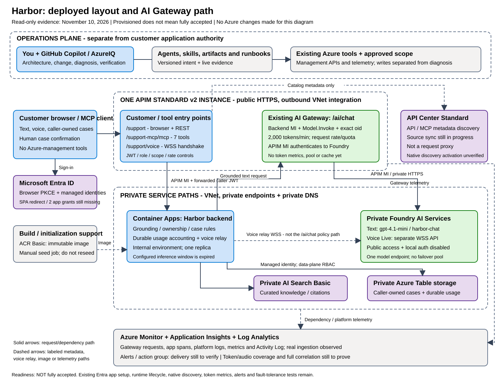

# Harbor layout, AI Gateway, and operating guide

**Evidence snapshot: November 10, 2026, 15:23-15:32 UTC.**
Read-only Azure/Graph configuration reads and payload-free Log Analytics
aggregates were used. This is a working operations reference, not a declaration
that every user flow is ready. No Azure resource or application was changed.

## 1. Layout at a glance



[Editable Excalidraw diagram](harbor-layout.excalidraw).
Open the editable file in the approved [Microsoft Excalidraw](https://aka.ms/excalidraw)
instance. Resource names and private scope IDs are deliberately omitted.

Two systems share this layout:

- **AzureIQ operations plane:** you describe an Azure outcome to GitHub Copilot.
  Agents, skills, existing Azure tools, versioned artifacts, and live telemetry
  support architecture, changes, diagnosis, performance, and reliability work.
  This plane uses the operator's approved Azure scope and authority.
- **Harbor customer plane:** a fictional IT support application with a browser,
  grounded text, controlled voice, caller-owned cases, and seven selected tools.
  It does **not** inherit AzureIQ's Azure-management authority.

### Confirmed configuration versus readiness

| Component | Current observation | What it does not prove |
|---|---|---|
| APIM | Standard v2, Succeeded; public HTTPS gateway with outbound VNet integration | End-to-end customer or model authorization |
| Support API | `/support`; browser assets and REST operations behind APIM | Customer sign-in works |
| Model API | `/ai/chat`; AI controls listed below are present in actual policy | A real model invocation has succeeded |
| Voice API | WebSocket `/support/voice`; operation-scoped handshake policy repaired | Real regional Voice Live audio/contract compatibility |
| Executable MCP | API type `mcp`, `/support-mcp`; seven mappings verified November 9 | Successful authenticated tool execution |
| API Center | Standard, Succeeded; source still reports `syncing` on November 10 | Completed convergence, native discovery activation, or linked billing benefit |
| Container Apps | Internal environment, public access Disabled, one min/max replica, existing immutable image | Horizontal HA or healthy upstream dependencies |
| Foundry | Private/public access Disabled, local auth disabled; `gpt-4.1-mini`, version `2025-04-14`, deployment `harbor-chat`, GlobalStandard capacity 1, Succeeded | Quota available for every request, or voice compatibility |
| AI Search | Basic, private, local auth disabled | Exact seeded document/schema/hash readback |
| Storage | Public access Disabled, Shared Key disabled; Table is the case/usage store | Backup/restore or independent data verification |
| Telemetry | Gateway/application/activity/metrics and Container Apps records exist | All desired signals, traces, and alert delivery are covered |

### Current activation gaps

The November 10 read still shows **no SPA redirect, no backend `Model.Invoke`
assignment, and no gateway `Support.Gateway` assignment**. They are precise
Entra application settings/grants, not a need to activate PIM or grant the
agent a new directory administrator role.

The local operator guide with exact private bindings is under ignored
`.azureiq/plans/CHG-HARBOR-CONTINUE-20261109/ENTRA-ADMIN-STEPS.md`.
An already-authorized application administrator can complete the three changes;
never paste credentials into chat.

**A separate runtime issue is also present:** the deployed application's
`LabWindowEndsAt` is still November 9, 21:25:43 UTC, now past. Deployment cutoffs
were removed, but the code still deliberately rejects inference outside that
window. Removing short-lived runtime windows for an ongoing service requires
an explicit lifecycle implementation change that preserves usage accounting,
quotas, and concurrency controls. Do not repeatedly extend dates, delete the
Budget row, or change the lab ID to manufacture a new allowance.

These are readiness gates, not evidence that the infrastructure was undeployed.

## 2. What the APIM AI Gateway actually is

**AI Gateway is a capability of the existing APIM service, not another required
Azure service or a separate gateway to install.** APIM sits between a caller
and AI endpoints, applying identity, quotas, routing, safety, and telemetry.
Azure OpenAI/Foundry still hosts and runs the model.

We already have an initial AI Gateway:

```text
Browser -> APIM support API -> Harbor backend
                                  |
                                  | backend managed-identity token
                                  v
                           APIM POST /ai/chat
                                  |
                                  | APIM managed-identity token
                                  v
                   private Foundry Chat Completions endpoint
```

The backend first retrieves approved Search evidence. Its model request
contains the question, selected evidence, and synthetic service status. The
backend validates citations and disallows unsupported action claims. APIM
governs the model call; **it does not replace retrieval, ownership checks, case
confirmation, or grounding validation in the application**.

### What is already configured on the live model route

Source intent is [chat.xml](../infra/support-service/policies/chat.xml);
the November 10 live policy independently confirms:

| Control | Actual configuration |
|---|---|
| Inbound caller | Signed customer-tenant JWT validation for the API audience; requires `Model.Invoke` and the exact backend principal's `oid` |
| Request rate | 20 requests/minute keyed to the backend principal |
| Request quota | 200 calls per 86,400-second quota period |
| Token rate | `azure-openai-token-limit`, **2,000 prompt/completion tokens per minute**, prompt estimation enabled |
| Upstream identity | APIM managed identity, resource `https://cognitiveservices.azure.com` |
| Upstream route | `/openai/deployments/harbor-chat/chat/completions?api-version=2024-10-21` |
| Forwarding | Non-streaming current client, timeout 60 seconds at APIM |
| Application ceilings | Actual output limit 512 tokens; reference app also caps concurrency and durable usage |

The application has a shorter default provider timeout of 20 seconds, so it
can cancel before the gateway's 60-second timeout. Preserve that distinction
when investigating 504s or tuning timeout budgets.

The gateway currently has **zero named backend entities**, one model deployment,
no token-emission policy, no semantic-cache policy, and no retry policy.
The model service URL is currently configured directly on the API rather than
through a named backend/pool.

### Three gateway functions that should not be confused

1. **Model governance:** `/ai/chat` authenticates the backend and governs text
   inference, then calls Foundry.
2. **Tool governance:** `/support-mcp/mcp` exposes the selected REST operations
   as executable tools. Its JWT scope/role/rate controls apply to tool callers.
   The backing support API still performs the customer/gateway authorization.
3. **Discovery:** API Center catalogs APIs and MCP servers. Its native
   `mcp_registry_search`/`mcp_registry_fetch` endpoint is separate; discovering
   a tool neither executes it nor grants access.

**Voice is a fourth, different path.** Browser WSS passes through APIM's
handshake into the Harbor relay; the relay then connects to private Foundry
Voice Live using its own managed identity. It does not call `/ai/chat`.
Chat token limits, token metrics, caching, and backend pools therefore do not
automatically govern the voice stream. APIM policy execution on a WebSocket
handshake is not per-audio-message policy execution.

## 3. Practical AI Gateway adoption path for this setup

The recommendation is **finish the existing route first, add token telemetry
second, add resiliency third, and defer caching until safe reuse is measurable**.
No new APIM instance is needed.

| Stage | Bounded change or activity | Acceptance evidence |
|---|---|---|
| 0. Make existing flows usable | Complete exact Entra settings/grants; resolve the obsolete runtime-window lifecycle without resetting accounting; verify source sync/native catalog access | Customer sign-in; protected customer route; backend-to-APIM authorization; one approved grounded inference; deny direct/unauthorized callers |
| 1. Establish AI measurements | Add token metrics to the current model API, verify keyless APIM-to-Insights telemetry and low-cardinality dimensions; preserve payload privacy | Actual prompt/completion/total token series for a known request, latency/dependency trace, expected dimensions, no prompt/body/token leakage |
| 2. Exercise existing governance | Test current token/rate/concurrency/durable-accounting boundaries using bounded authorized synthetic requests | Expected admission and deny responses localized to the correct hop; documented headroom; limits do not silently increase |
| 3. Name the existing backend | Represent the same private model endpoint as an APIM backend entity; preserve URL, identity, model/version and network path | Same response schema/citations and equivalent private/auth behavior before and after |
| 4. Add real failover capacity if justified | Add a separately approved compatible model endpoint/region, named pool, circuit breaker and bounded retry policy | Simulated overload/unavailability uses only the approved alternative; no retry storm, excessive latency or unbudgeted generation |
| 5. Optional safety and FAQ optimization | Evaluate content safety first; evaluate semantic caching only for non-personal approved FAQ content | Positive and negative tests; no cross-user reuse, stale-status/case answers, or bypass of auth/grounding |

These are proposed changes, **not completed configuration**. Use versioned
artifacts and the [observability workflow](observability-changes.md) where
applicable; keep the successfully deployed older versions immutable.

### Token telemetry and quotas

Microsoft's current documentation uses `llm-token-limit` and
`llm-emit-token-metric`; the older Azure OpenAI policy reference links redirect
there. The deployed policy still uses `azure-openai-token-limit`. Treat any
name/schema migration as a tested policy revision, not an unexplained edit.

- Use dimensions such as application=`Harbor`, route=`chat`, model deployment,
  region and outcome. **Do not use prompt text, case IDs, bearer tokens or
  unbounded user IDs as metric dimensions.**
- Token emission needs Application Insights integration, logging enabled for
  the model API, and custom metrics with dimensions enabled. Existing logger
  configuration alone is not proof of token metric delivery.
- Request limits, token limits, model capacity/quota, and application durable
  budgets are different controls. The app's 100-request window ceiling can
  bind before APIM's 200-call daily quota.
- The current token counter is shared by the backend identity, **not divided
  by end customer**. Keep authoritative per-caller accounting in the app.
  A future per-customer gateway key needs trusted identity propagation; never
  trust an arbitrary caller-supplied header.
- Token counts and enforcement are not a hard invoice cap. Counters operate
  per gateway; future regional/workspace gateways do not magically share one
  globally exact budget. Account for distributed/in-flight requests.

### Reliability without pretending that one endpoint is failover

A circuit breaker protects an unhealthy backend; **it cannot create spare
model capacity**. A pool with one endpoint is not redundancy. For Harbor:

- Start with a named backend for the already-deployed model.
- Add a second endpoint only after confirming equivalent API/model/version,
  approved geography, identity grants, quota and total spend.
- Use weighted or priority routing as intended; test the actual provider
  `Retry-After` behavior and circuit recovery.
- Do not retry 401/403 or content/contract validation errors. Honor bounded
  retry budgets for transient failures/429s, cancellation and the app deadline.
  Duplicate model attempts can be billed even if only one answer is returned.
- Preserve citation/grounding checks across failover. Do not silently downgrade
  to a different model or return a fake successful answer.

### Why semantic caching is not the first addition

Semantic caching requires an embeddings-compatible service and a supported
external cache (such as Azure Managed Redis), plus identity/network/cost work.
Harbor currently uses lexical Search and has no cache or embedding service.
Cache only a deliberately selected FAQ path, with company/auth boundaries,
knowledge/prompt/model-version keys and an approved expiration/invalidation
strategy. Exclude cases, synthetic/live status, proposals, confirmations,
commits, customer-specific responses and voice tickets. Measure hit quality
and cost before claiming a benefit; there is no guaranteed percentage saving.

Content safety is an optional additional service/policy decision, not a
replacement for authorization, tool allowlists or explicit case confirmation.

## 4. How to use the whole system

### As the Azure operator

Describe goals in ordinary GitHub Copilot Agent mode. Examples:

- "Show Harbor's deployed topology, current identities and telemetry gaps."
- "Trace this 502 at 14:32 UTC through APIM and the backend. Do not make changes."
- "Explain whether the 429 is our token limit, the app budget or Foundry quota."
- "Compare p95 grounded-chat latency with the baseline and identify the slow hop."
- "Plan fault tolerance for this setup while preserving privacy and the current budget."
- "Add token metrics to the existing model route, show the diff and verify delivery."

AzureIQ should select the relevant inventory/incident/planning/verification
workflows and tools. You do not need to name an agent or memorize its commands.
Diagnosis remains read-only; a requested implementation proceeds through the
bounded change and verification path. Ordinary VS Code sessions are interactive,
**not an always-on monitor**. Continuous detection needs deployed Azure alerts
or automation, durable state, managed identity and deliberately scoped authority.

### As a Harbor customer, once activation gates pass

1. Open the public APIM application URL, obtain the non-secret browser config
   and sign in using Entra authorization-code/PKCE.
2. Browse approved services and explicitly synthetic status. Ask a
   company-scoped question; the backend searches the eight curated synthetic
   documents and returns source/version citations with its answer.
3. List only your own cases. Prepare a proposal, review the UI card, deliberately
   confirm, then commit with its exact hash/grant and an idempotency key.
   A proposal, model answer or spoken "yes" is **not** case creation.
4. For voice, explicitly consent to microphone/processing. The backend reserves
   bounded usage and issues a single-use ticket; browser WSS uses the returned
   URL and fixed subprotocols. Tickets never belong in the URL or logs.
5. Tools can prepare a proposal, but cannot confirm/commit it or manage Azure.

No real password resets, remote commands, billing actions, customer messaging
or arbitrary tenant operations are exposed by this fictional support app.

### As an MCP client

Use the authenticated executable endpoint `/support-mcp/mcp`, retaining the
reviewed user/token requirements. Available tools:

| Tool | Purpose |
|---|---|
| `company_info` | Fixed fictional company and privacy context |
| `service_catalog` | Approved service list |
| `service_status` | Explicitly synthetic status |
| `search_knowledge` | Curated company evidence |
| `list_my_cases` | Current caller's cases |
| `get_my_case` | Current caller's selected case |
| `prepare_case` | Expiring proposal, not case creation |

API Center's native discovery client is a **separate activation and validation**
task. Source linking/imported APIs do not prove that the portal or native MCP
endpoint is enabled, authenticated or usable.

## 5. Diagnosis: start from one request, not a random restart

### Evidence to capture

Record UTC time/window, host/path/method, expected versus actual outcome,
non-secret gateway request ID, API/operation/revision and affected user flow.
Do not collect prompts, case bodies, audio, browser tokens, cookies, connection
strings or WebSocket ticket subprotocols. A request replay that creates data,
uses paid inference, sends alerts or accesses a microphone needs its applicable
authorization/consent.

Use this hop order:

1. **Client and sign-in:** actual responding host, SPA redirect, tenant,
   audience, delegated scope/customer role, browser console with secrets removed.
2. **APIM inbound:** effective global/API/operation policy and gateway request
   record. Did a backend call occur? Which status/error section was recorded?
3. **Private backend:** request/dependency spans, revision/image/replica health,
   correct gateway and forwarded-customer identities, durable admission.
4. **Dependencies:** Search evidence lookup; Table authorization/ETag admission;
   APIM model API; Foundry token acquisition/quota/response contract.
5. **Response transformation:** gateway `on-error` or app safe error mapping may
   turn an upstream status into a generic502. Inspect both hops before blaming
   the last visible service.
6. **Telemetry coverage:** an empty table is not health or proof no request ran.
   Check destination, enabled categories, table mode, schema, retention,
   sampling, query permissions and ingestion lag.

### Common symptoms in this specific architecture

| Symptom | First discriminating checks | Do not do |
|---|---|---|
| Redirect/sign-in error | Exact SPA callback; actual app registration and requested scope | Re-register everything or create a secret |
| 401/403 on customer REST | Customer role/scope/audience; gateway `Support.Gateway`; forwarded JWT; compare APIM/backend status | Remove JWT validation |
| Chat403/503 before a provider call | `lab_window_closed`/`lab_not_configured`, expired user auth, missing bindings or MI authentication | Delete/rebind usage rows or assume Foundry is down |
| Chat429 | App caller-minute/global/concurrency counters, APIM request/token counters, upstream Foundry quota | Automatically increase every limit |
| Model502 | `Model.Invoke`/backend `oid` validation, APIM MI Foundry role, upstream response, citation/schema validation | Return a fixture answer |
| Slow text | Search dependency time, APIM model `BackendTime`, app/provider timeout, model capacity and warm replica state | Add caches or retries before measuring |
| Knowledge query denied/empty | Private DNS/endpoint, data-plane Search role, index name/schema/doc versions, selected service/query | Treat no result as permission to invent an answer |
| Case failure or conflict | Caller partition, exact proposal hash/expiry/grant, idempotency key, Table permissions/ETags | Retry a commit with a new key or bypass confirmation |
| Voice fails at connect | Session issuance first; single-use ticket/Origin/subprotocol; APIM `onHandshake`; gateway MI JWT | Put browser bearer/ticket into a URL |
| Voice connects but no audio/tool result | Relay events, provider API/model/version compatibility, audio format and idle/lease/concurrency limits | Assume chat AI policies govern audio frames |
| MCP tools missing or rejected | Actual API `type: mcp`, exact seven absolute backing operation IDs, JWT policy, backing support API | Reintroduce `sourceApiId` REST cloning or expose commit as a tool |
| API Center stale/missing | Link state/time, exact source-reader identity/scope, imported definitions and native endpoint activation | Equate source creation with native discovery success |
| Gateway fails to reach a private service | Current Standard v2 outbound integration, exact NSGs/delegation/routes, DNS answer and TLS from the service network | Apply classic APIM-injection requirements blindly |

For an actual Azure diagnosis, produce **Problem Definition**, **Diagnosis**,
and **Root Cause Analysis** with confirmed/probable/undetermined confidence,
and distinguish faults from intended deny behavior.

### Reuse existing evidence queries instead of starting from scratch

| Evidence | Existing artifact / how to use it |
|---|---|
| Gateway route/status/timing/error | [request-evidence.kql](../support-domains/api-management/queries/request-evidence.kql), catalog `apim.request-evidence@0.2.0`; narrow to the actual API/request and absolute UTC window |
| Cross-service trace | [distributed-trace-correlation.kql](../support-domains/azure-monitor/queries/distributed-trace-correlation.kql), catalog `azure-monitor.distributed-trace-correlation@0.1.0`; start from actual App* `OperationId` |
| Backend platform state | [platform-evidence.kql](../support-domains/container-apps/queries/platform-evidence.kql), catalog `container-apps.platform-evidence@0.1.0`; **its current query targets legacy `_CL` fields**. Harbor's actual dedicated tables are `ContainerAppSystemLogs` / `ContainerAppConsoleLogs`; inspect their schema and parameterize a compatible candidate rather than paste the legacy query unchanged |
| Step-by-step response localization | [unexpected-response.md](../support-domains/api-management/runbooks/unexpected-response.md), catalog `apim.unexpected-response@0.2.0` |
| Log/alert configuration changes | [observability-changes.md](observability-changes.md) and catalog-bound alert packages; configuration readback is not delivery proof |

**Identifier warning:** gateway `CorrelationId` is not automatically the same as
Application Insights W3C `OperationId`. The backend-to-model APIM request is a
second gateway hop with its own request ID. Use actual trace propagation,
timestamps and span parentage; never join unlike identifiers and call it a
proven end-to-end trace.

### What telemetry actually exists

November 10 payload-free queries found these records within the preceding24h:

| Stream | Rows observed | Latest event UTC |
|---|---:|---|
| `ApiManagementGatewayLogs` | 197 | Nov10 09:56:28 |
| `AppRequests` | 3,080 | Nov10 15:24:15 |
| `AppDependencies` | 2 | Nov9 22:09:34 |
| `AppExceptions` | 196 | Nov10 09:56:28 |
| `AzureActivity` | 794 | Nov10 15:22:44 |
| `AzureMetrics` | 2,367 | Nov10 15:17:00 |
| `ContainerAppConsoleLogs` | 6 | Nov9 19:29:34 |
| `ContainerAppSystemLogs` | 28 | Nov9 20:02:17 |

Counts are a snapshot, not an SLO result or a diagnosis of the exception rows.
Gateway, dependencies and platform logs may be quiet while health probes keep
application requests active. Separate queries returned no recent rows for the
selected LLM/MCP/WebSocket specialized tables; table presence alone does not
prove their diagnostic categories or token/audio coverage are enabled.

The gateway diagnostic setting exports `GatewayLogs` and `AllMetrics` to
resource-specific tables. Workspace retention is30days and its configured
daily quota is0.05GB. Treat this cap as a potential visibility limit, not a
guaranteed exact ingestion/spending stop. Check ingestion health before
interpreting a log gap.

The November 10 alert read found one enabled severity2 `Requests` metric
alert with one action-group binding, an enabled existing destination action
group, and **zero scheduled-query rules** in the Harbor resource group.
Subscription Activity Log export includes Administrative, Security,
ServiceHealth, Alert, Recommendation, Policy, Autoscale and ResourceHealth.
No notification was sent for this guide. A telemetry-health scheduled alert
and tested delivery must not be reported as already deployed.

OpenTelemetry instrumentation includes `Harbor.Support` activities and metrics
for provider duration, voice termination and case commits. The privacy processor
removes query/header/body/prompt tags and exception details. That is deliberate;
diagnosis must work with safe codes and spans, not secret-bearing payload dumps.

For a telemetry-health alert, reuse the existing
`observability.apim-telemetry-health-alert@0.1.0` candidate. It compares exported
request metrics with missing gateway logs; **if both exports fail it has a blind
spot**. Validate idle/no-alert and traffic-with-missing-logs cases and approved
notification delivery. Do not call an alert path verified from an action group
or rule merely existing.

## 6. Performance, fault tolerance and proving this as an engineering lab

This is a non-production learning baseline, not a high-availability design:
one application replica, one Basic Search unit, LRS Table storage, one model
endpoint and one region. No tested DR/restore or regional failover is claimed.

| Exercise | Baseline / controlled test | Evidence required before changing architecture |
|---|---|---|
| Text performance | Grounded FAQ requests, token counts, input/output size, p50/p95 per hop | Separate retrieval, gateway, model and app times; establish an explicit SLO rather than invent one |
| Capacity | Bounded authorized concurrent requests against unchanged limits | Which admission control binds first, queue/cancellation behavior, costs and failed-request accounting |
| Model resilience | Approved controlled upstream429/503/unavailability | Circuit/pool/retry behavior, total latency, duplicated token charges, citation integrity |
| Application availability | Approved restart/revision exercise with synthetic tickets/proposals | Lost in-memory voice state versus durable Table counts; no duplicate case commits |
| Data protection | Separately approved synthetic backup/restore or recreation exercise | Restore ownership, knowledge hashes/schema, case/usage consistency and measured RPO/RTO |
| Observability | Approved low-risk synthetic transaction and alert test | New ingestion, distributed correlation, correct receiver, no sensitive payload logging |

**Do not simply raise max replicas.** The current voice leases and concurrency
state are process-local, and the deployed reference deliberately pins one
replica. Multi-replica operation needs a design for shared/partitioned leases,
global concurrency, connection routing, idempotency and failure recovery before
it becomes an HA fix.

Separate two approvals when necessary: authorization to perform a change and
the customer's deliberate case/microphone confirmation. Neither a model nor
an operator test should forge the latter.

## 7. Recommended next work, in order

1. Complete the three existing-administrator app changes and read them back.
2. Replace the obsolete disposable inference-window lifecycle with an approved
   ongoing-service lifecycle, preserving quotas/accounting and testing denial
   semantics; do not make a deadline-tag extension the operating procedure.
3. Verify customer REST, grounded text, exact case confirmation/idempotency and
   controlled voice against real services.
4. Confirm catalog convergence and deliberately enable/test native authenticated
   discovery. API Center billing benefit remains unverified until corroborated.
5. Add AI token metrics and prove correlation, privacy and alert delivery.
6. Establish measured performance/SLO baselines; only then add named backend,
   circuit breaker/pool and optional safety/cache capabilities as justified.
7. Exercise failure/restore/recreation and independent acceptance before
   promoting any candidate to a proven production baseline.

This document and diagram do not authorize any of those Azure mutations.

## References

- [APIM AI Gateway capabilities](https://learn.microsoft.com/azure/api-management/genai-gateway-capabilities)
- [LLM token limits, status codes and gateway counter scope](https://learn.microsoft.com/azure/api-management/llm-token-limit-policy)
- [Token metrics and cardinality/prerequisites](https://learn.microsoft.com/azure/api-management/llm-emit-token-metric-policy)
- [Backend pools and circuit breakers](https://learn.microsoft.com/azure/api-management/backends)
- [Semantic cache prerequisites](https://learn.microsoft.com/azure/api-management/azure-openai-enable-semantic-caching)
- [Content safety policy](https://learn.microsoft.com/azure/api-management/llm-content-safety-policy)
- [REST-backed executable MCP management](https://learn.microsoft.com/azure/api-management/manage-mcp-servers-rest-api)
- [Application routes, authorization and voice contract](../case-study/SupportService/README.md)
- [Successful MCP completion source](../infra/support-api-repair/mcp-completion.bicep)
- [Existing AI Gateway policy source](../infra/support-service/policies/chat.xml)
